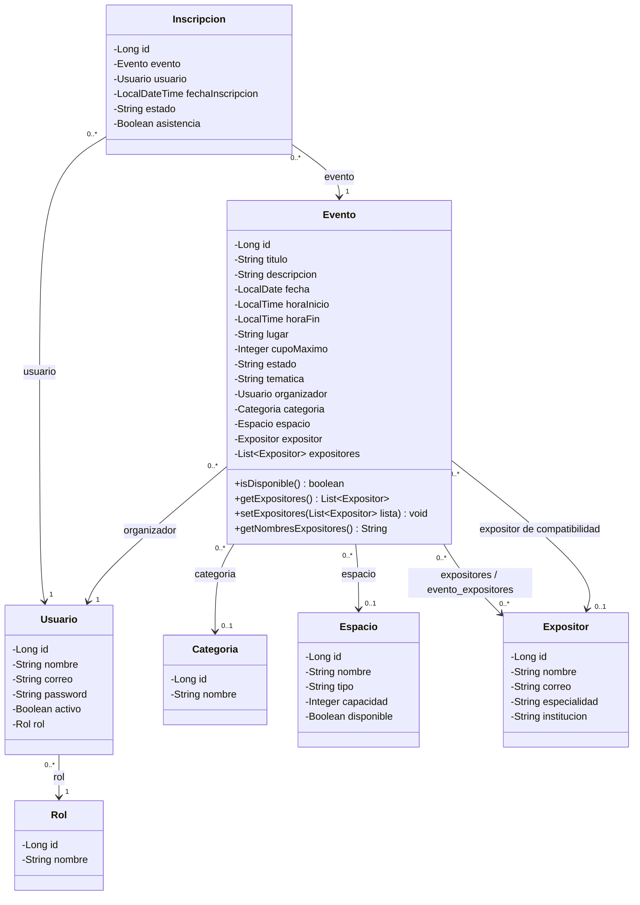

# Diagrama de clases técnico · Módulo 6

Representa las clases Java actuales. Se divide en dos vistas para distinguir las entidades de las operaciones. Se omiten constructores, getters y setters comunes, controladores y clases auxiliares.

## Entidades y relaciones

Las multiplicidades reflejan el mapeo persistente actual. Aunque categoría y espacio admiten valores nulos para registros anteriores, `EventoService.validar()` exige categoría, sala disponible y al menos un expositor al guardar o publicar. También exige un cupo positivo que no supere la capacidad de la sala.

`evento_expositores` es la tabla intermedia administrada mediante `@ManyToMany` y `@JoinTable`; no existe una clase Java `EventoExpositor`. El atributo individual `expositor` y el texto `tematica` se conservan por compatibilidad con datos anteriores. La contraseña de `Usuario.password` se guarda como hash.

## Servicios y persistencia

```mermaid
classDiagram
    direction TB

    class AuthService {
        -UsuarioRepository usuarioRepository
        +autenticar(String correo, String password) Usuario
    }
    class UsuarioRepository {
        +findByCorreo(String correo) Usuario
        +findById(Long id) Usuario
        +findAll() List~Usuario~
        +roles() List~Rol~
        +administrar(Long id, String nombre, String correo, String passwordHash, Long rolId, boolean activo, Long actorId) Usuario
    }
    class EventoService {
        -EventoStore eventos
        -Clock reloj
        +validar(Evento e) void
        +guardar(Evento e) void
        +publicar(Evento e) void
        +cancelar(Evento e) void
        +reactivar(Evento e) void
    }
    class EventoStore {
        <<interface>>
        +findById(Long id) Evento
        +findAll() List~Evento~
        +save(Evento evento) void
        +update(Evento evento) void
        +reactivar(Long id) void
    }
    class EventoRepository {
        +findById(Long id) Evento
        +findAll() List~Evento~
        +save(Evento evento) void
        +update(Evento evento) void
        +reactivar(Long id) void
        -bloquearYValidar(EntityManager em, Evento evento) void
    }
    class InscripcionRepository {
        -Clock reloj
        +inscribir(Long eventoId, Long usuarioId) void
        +cancelarInscripcion(Long eventoId, Long usuarioId) void
        +contarInscritos(Long eventoId) long
        +estaInscrito(Long eventoId, Long usuarioId) boolean
        +listarPorEvento(Long eventoId) List~Inscripcion~
        +registrarAsistencia(Long eventoId, Long inscripcionId, Long usuarioId, String rol, boolean asistio) void
    }
    class CatalogoEventosRepository {
        +categorias() List~Categoria~
        +registrarCategoria(String nombre) void
        +expositores() List~Expositor~
        +espacios() List~Espacio~
        +actualizarEspacio(Espacio datos) void
        +guardar(Object entidad) void
    }

    AuthService --> UsuarioRepository : consulta la cuenta
    EventoService --> EventoStore : utiliza
    EventoRepository ..|> EventoStore : implementa
```

| Operación del modelo conceptual | Implementación actual |
| --- | --- |
| Iniciar sesión | `AuthService.autenticar()`; `AuthController` establece la sesión. |
| Publicar y cancelar un evento | `EventoService.publicar()` y `EventoService.cancelar()`. |
| Cancelar una inscripción | `InscripcionRepository.cancelarInscripcion()`. |
| Validar disponibilidad del espacio | `EventoService.validar()` comprueba disponibilidad y capacidad; `EventoRepository.bloquearYValidar()` comprueba cruces de horario dentro de la transacción. |
| Asociar expositores | `Evento.setExpositores()` y la relación JPA sobre `evento_expositores`. |
| Consultar inscritos y registrar asistencia | `InscripcionRepository.listarPorEvento()` y `registrarAsistencia()`. |

Los controladores verifican sesión, rol y CSRF antes de ejecutar las escrituras. DOCENTE organiza sus eventos y gestiona expositores; ESTUDIANTE se inscribe y cancela su inscripción; ADMIN supervisa y administra salas, categorías y cuentas compartidas. `PermisosEventos` concentra los permisos principales de eventos.
