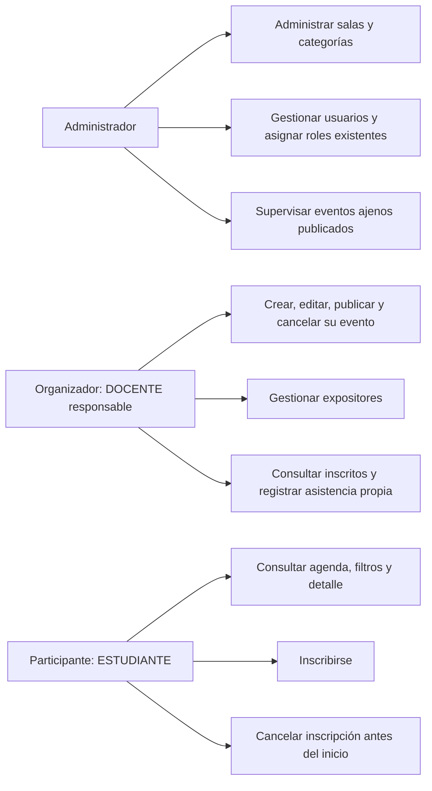
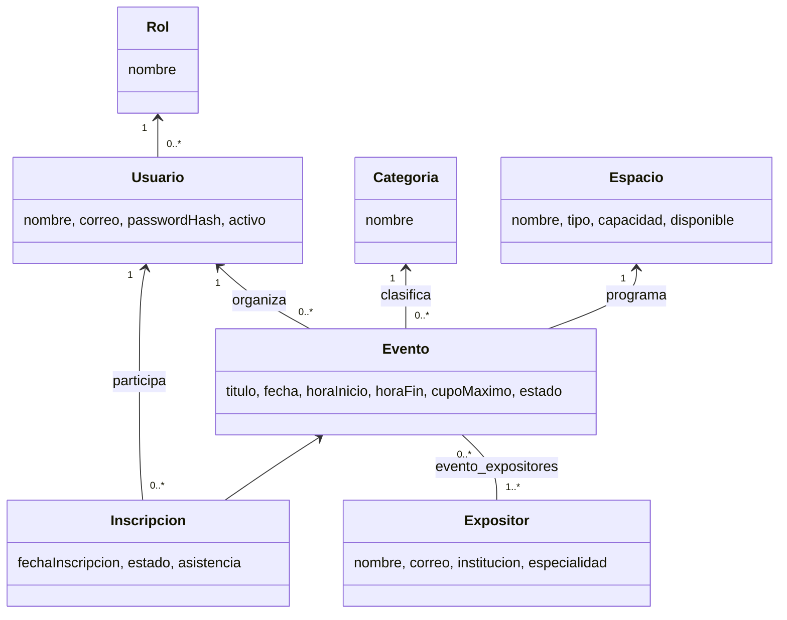
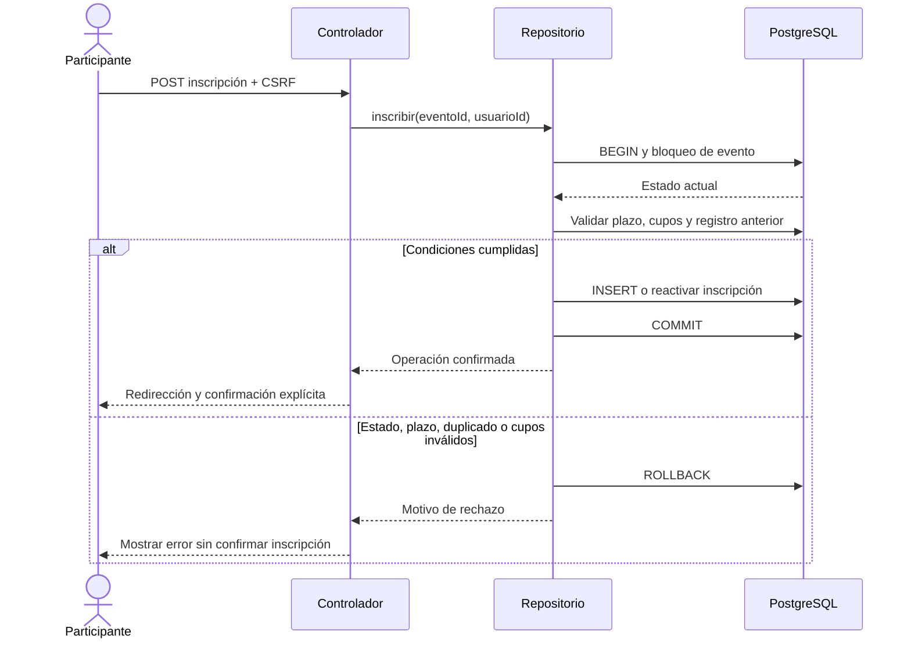
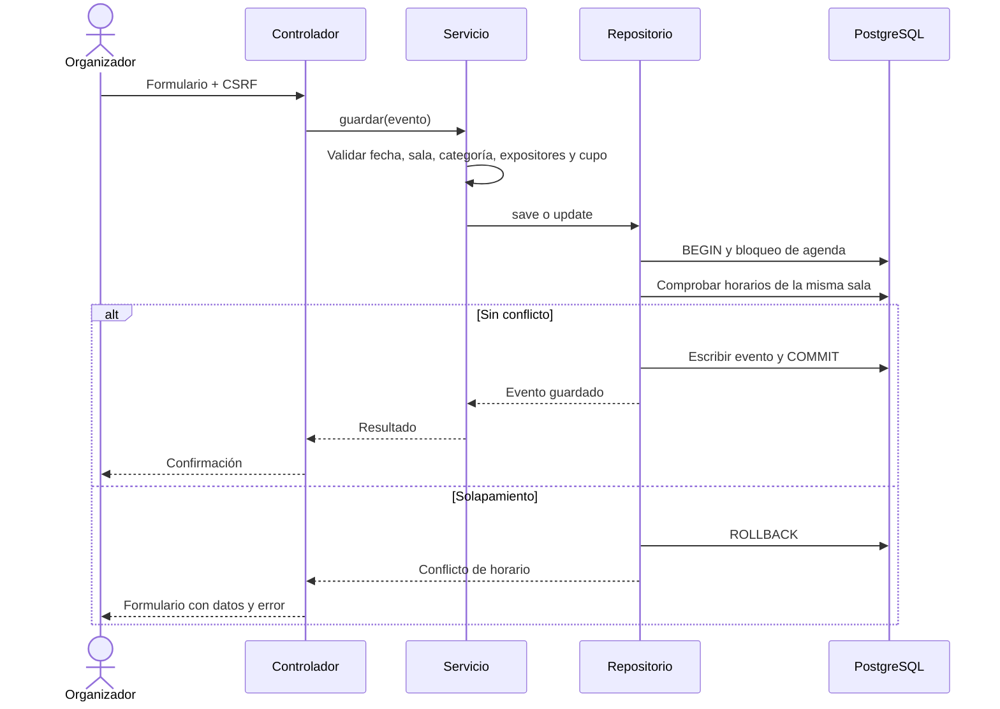
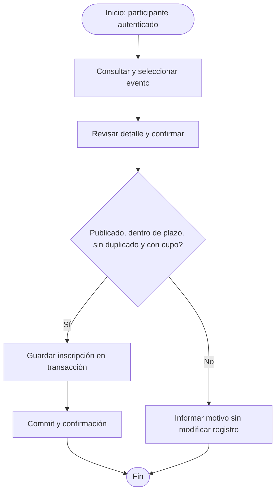
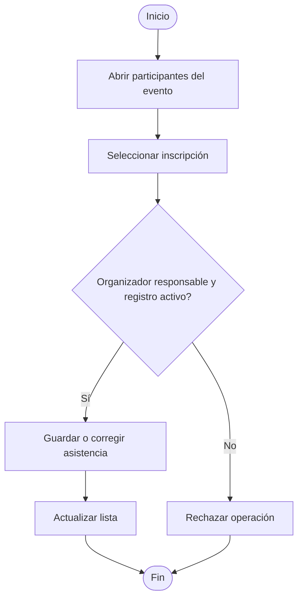

# Diagramas editables del módulo 6

Estas fuentes documentan el diseño actual. Las versiones SVG y PDF se regeneran mediante scripts/generar_informe.py. Las relaciones compartidas deben revisarse al integrar con otros módulos.

## Casos de uso por actor

## Clases y relaciones

## Secuencia: inscribirse

## Secuencia: programar evento

## Actividad: inscripción

## Actividad: asistencia

