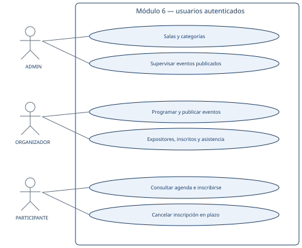
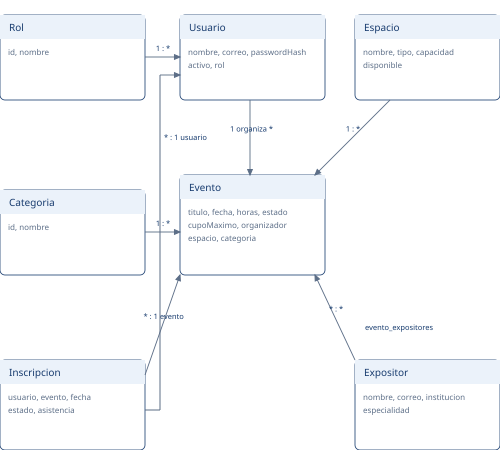
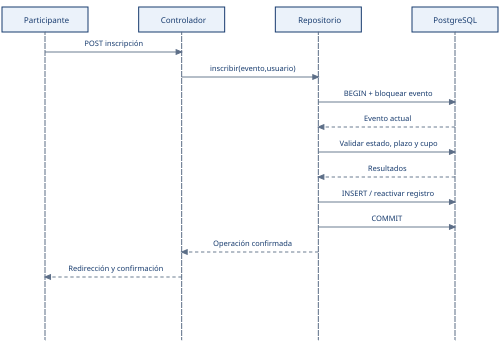
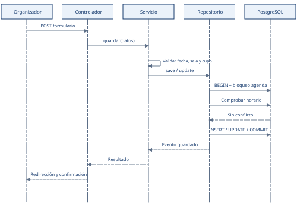
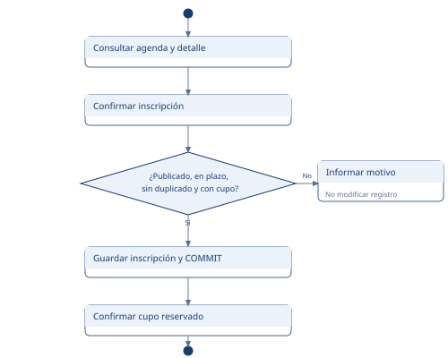
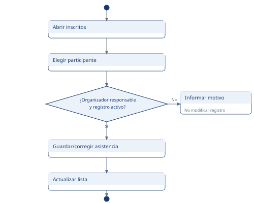

# Informe técnico del módulo 6
## Sistema de gestión de eventos académicos

Taller de Ingeniería de Software · Universidad Católica del Norte

Grupo 6: Arion Martin, Dan Gómez, Patricio Alvarado, David Aros y Gabriel Becerra, según el informe inicial proporcionado por el equipo.

Versión técnica: 12 de noviembre de 2026. Documento de apoyo para revisión y defensa. Se basa en el informe inicial Informe_INGESO-2.pdf y en la pauta Taller_de_ingenieria_de_software.pdf; no reemplaza la revisión académica del equipo.

## 1. Problema y alcance

La información de eventos distribuida entre correos, afiches y redes dificulta la consulta de horarios y ubicaciones. Las inscripciones manuales favorecen duplicados, exceso de cupos y problemas de trazabilidad. El módulo centraliza programación, difusión, inscripción y asistencia.

Incluye usuarios autenticados, eventos, expositores, categorías, salas compartidas, control de cupos y asistencia. La administración global de cuentas y roles permanece a cargo del sistema base, fuera del alcance del Grupo 6. Excluye presupuestos, proveedores, inventario, externos e integración automatizada con sistemas universitarios. Las reservas generales pertenecen al equipo responsable de ese módulo.

## 2. Actores y permisos

| Rol | Actor | Responsabilidades |
| --- | --- | --- |
| ESTUDIANTE | Participante | Consultar, buscar, filtrar, revisar detalle, inscribirse y cancelar antes del inicio. |
| DOCENTE | Organizador | Administrar sus eventos y expositores; listar participantes y registrar asistencia de sus participantes; no se inscribe. |
| ADMIN | Administrador | Gestionar salas y categorías; supervisar eventos ajenos publicados o finalizados sin modificarlos. |

La equivalencia de los roles compartidos con los actores es una decisión de diseño del equipo. ADMIN puede organizar sus propios eventos para conservar la responsabilidad de los existentes. No puede editar, cancelar, reactivar ni registrar asistencia de un evento ajeno. Un borrador es privado de su organizador autorizado.

## 3. Requisitos y trazabilidad

| ID | Comportamiento implementado | Evidencia |
| --- | --- | --- |
| RF-01 | Inicio de sesión y permisos de eventos por rol. | Pruebas de autenticación y autorización del módulo. |
| RF-02 | Crear, editar, publicar y cancelar eventos propios. | Servicio, persistencia y navegador. |
| RF-03 | Buscar por texto y filtrar por categoría o fecha. | Agenda y recorrido de navegador. |
| RF-04 | Inscribir y cancelar estrictamente antes del inicio. | Pruebas de frontera temporal y transacción. |
| RF-05 | Controlar cupos y un único registro por usuario/evento. | Pruebas de ocho solicitudes simultáneas. |
| RF-06 | Listar inscritos, imprimir y registrar asistencia propia. | Autorización, integración y navegador. |
| RF-07 | Crear, editar y deshabilitar ubicaciones. | Catálogo y capacidad de eventos existentes. |
| RF-08 | Asignar sala, fecha y horas. | Formulario, servicio y persistencia. |
| RF-09 | Cupo no mayor que la capacidad de la sala. | Validaciones y edición de ubicación. |
| RF-10 | Impedir solapamiento de eventos no cancelados. | Transacciones y cuatro escrituras simultáneas. |
| RF-11 | Registrar/editar expositores y asociar varios. | Relación muchos a muchos y catálogo. |
| RF-12 | Mostrar fecha, horario, ubicación, cupos, categoría y expositores. | Ficha individual en escritorio y móvil. |

## 4. Reglas de negocio y decisiones

- Cada evento tiene un organizador, título, fecha, horario, sala y cupo positivo. El inicio debe estar en el futuro al guardar o publicar.
- La hora de término es posterior al inicio. Los eventos consecutivos en una misma sala se permiten; los intervalos solapados no.
- El cupo no supera la capacidad real de la ubicación ni puede reducirse por debajo de los inscritos activos.
- Las ubicaciones deshabilitadas no se asignan a eventos nuevos. La edición de una sala respeta los cupos de eventos programados.
- La inscripción requiere publicación, tiempo disponible, cupos y ausencia de otro registro activo del mismo usuario.
- El equipo definió el cierre de inscripción y cancelación en la hora de inicio. Al llegar a esa hora, la cancelación se rechaza sin alterar el registro.
- Cancelar una inscripción libera el cupo y conserva su historial. Una nueva inscripción reactiva el mismo registro.
- Solo el organizador responsable registra asistencia oficial de inscripciones activas de eventos publicados o finalizados.
- Recuperar un evento cancelado lo devuelve a borrador. Las inscripciones anteriores quedan canceladas; la fecha, sala y cupo se revisan antes de publicar otra vez.

## 5. Arquitectura y SOLID

Presentación: rutas Javalin, controladores y vistas JTE. Negocio: EventoService, PermisosEventos y PlazoCancelacion. Persistencia: repositorios JPA/Hibernate. PostgreSQL mantiene claves foráneas, unicidad y transacciones.

S: las responsabilidades HTTP, validación, autorización y acceso a datos tienen clases separadas. O y D: EventoService depende de EventoStore y un reloj intercambiable; se puede sustituir el repositorio o el tiempo de prueba sin cambiar las reglas. L: la implementación y el doble de prueba satisfacen el mismo contrato sin introducir herencia artificial. I: EventoStore expone solo las operaciones de eventos que necesita el servicio.

Las reglas que requieren atomicidad, como comprobar cupos o solapamientos antes de escribir, permanecen dentro de la transacción del repositorio. No se presenta esta decisión como una separación absoluta: responde al requisito de consistencia concurrente.

## 6. Modelo de clases y datos

| Tabla | Propósito y alcance |
| --- | --- |
| usuarios, roles | Compartidas. Se reutilizan para autenticación y permisos de eventos. Su gestión global pertenece al sistema base. |
| espacios | Compartida. Nombre, tipo, capacidad y disponibilidad. |
| eventos | Programación, estado, organizador, ubicación y categoría. |
| expositores | Nombre, correo, especialidad e institución. |
| evento_expositores | Asociación muchos a muchos, con clave compuesta. |
| categorias | Catálogo de clasificación. |
| inscripciones | Usuario/evento únicos, fecha, estado y asistencia. |

Temática y expositor_id se conservan para compatibilidad con semillas anteriores, mientras las pantallas nuevas trabajan con categoría y colección de expositores. Las migraciones son aditivas y no eliminan datos de los otros módulos.

## 7. Casos de uso principales

CU-01 — Inscribirse. Actor: participante autenticado. Precondición: evento publicado. El participante consulta la agenda, revisa el detalle y confirma. Se comprueban tiempo, cupos y duplicados en una transacción. Si se acepta, se guarda y confirma; si falla una condición, no se modifica la inscripción y se informa la causa. Postcondición: un único registro activo o ningún cambio.

CU-02 — Programar un evento. Actor: organizador. Selecciona categoría, uno o varios expositores y sala; introduce fecha, horas y cupo. El servicio valida y el repositorio serializa la comprobación de horarios y la escritura. Si hay conflicto, el formulario conserva los datos y muestra el motivo. El nuevo evento queda en borrador; publicar habilita la inscripción.

CU-03 — Registrar asistencia. Actor: organizador responsable. Consulta sus inscritos y marca o corrige la asistencia de una inscripción activa. Un administrador ajeno puede consultar un evento publicado, pero no modificar su asistencia oficial. La transacción conserva el estado de la inscripción y la corrección de una marca no crea un registro nuevo.

## 8. Secuencia: inscripción

El bloqueo de la fila del evento coordina a todos los participantes que compiten por cupos. La confirmación HTTP se produce únicamente después del commit de PostgreSQL.

## 9. Secuencia: programación

La comprobación de solapamiento y la escritura comparten transacción. El bloqueo de la tabla de eventos es una solución deliberadamente simple para el alcance del taller; limita la concurrencia de escrituras de agenda.

## 10. Actividad: inscripción

Un rechazo por estado, plazo, duplicado o falta de cupo conserva el estado anterior. El caso exitoso informa explícitamente que el cupo quedó reservado.

## 11. Actividad: asistencia

El organizador puede corregir una marca errónea. Un supervisor ajeno puede consultar el listado, pero no registra ni modifica la asistencia oficial.

## 12. Seguridad e integridad

Las contraseñas usan PBKDF2-HMAC-SHA256 con sal aleatoria y 600.000 iteraciones, mediante la API estándar de Java. El login no compara texto plano. Las semillas contienen hashes y una migración idempotente convierte cuentas anteriores sin cambiar su clave de acceso.

Las escrituras del módulo validan sesión, rol y CSRF. La administración de cuentas y sus sesiones pertenece a la base común del sistema. La autorización no depende de ocultar botones: se verifica en el servidor. Las vistas JTE escapan los datos de usuario.

Las inscripciones bloquean la fila del evento y conservan su unicidad. La agenda serializa sus escrituras. La edición no elimina registros con historial.

## 13. Pruebas y resultados

La suite actual ejecutó 44 pruebas con cero fallos y cero errores. Incluye validaciones de servicios y controladores, persistencia real, roles, asistencia, plazos y varios expositores. La configuración externa permite aislar la base usada por las pruebas.

Concurrencia: ocho peticiones del mismo usuario generan una inscripción; ocho usuarios que compiten por dos cupos aceptan exactamente dos; cuatro eventos que compiten por la misma sala y horario aceptan exactamente uno.

Rendimiento revalidado el 12/11/2026: 100 sesiones independientes, tres rondas y 300 consultas; cero errores, máximo 0.619212 s y P95 0.567522 s. La identidad de prueba es compartida, con cookies distintas, y la base contiene seis eventos y dos inscripciones. El login y calentamiento no forman parte del cronómetro. Esta medición local no garantiza el rendimiento con otra red, volumen de datos o carga sostenida.

Se verificó en Chrome el flujo de las tres cuentas, pantallas de escritorio y móvil, varios expositores, filtros, asistencia, confirmaciones. Los registros temporales fueron retirados.

## 14. Instalación limpia

Se clonó el commit e4c8a3d0e66cbf602a93f68c45786dd0de171788 sin archivos generados del directorio original. Un PostgreSQL 16 temporal aplicó los scripts desde cero. Maven compiló, generó JTE y ejecutó 42 pruebas. La aplicación inició y validó las tres cuentas y cuatro eventos iniciales. Las rutas del panel global retirado devolvieron 404 para los tres roles, mientras los permisos de eventos se conservaron.

Se retiraron únicamente la aplicación y contenedor temporales. El volumen y servidor habituales se conservaron. El README incluye inicio desde GitHub, migraciones para una base existente y configuración por entorno. La caché Maven del usuario estaba disponible; no se afirma una prueba sin conexión a Maven Central.

## 15. Integración y decisiones compartidas

Los nombres ADMIN, DOCENTE y ESTUDIANTE se mantienen porque sus tablas son comunes. El módulo no crea, edita ni desactiva usuarios ni administra roles; utiliza los valores definidos por el proyecto base. La migración a hashes exige que los módulos que autentican usuarios utilicen el verificador común. No se altera la estructura de las tablas de usuarios y roles.

Las ubicaciones reutilizan espacios; sus cambios afectan al catálogo compartido. La coordinación con reservas generales debe confirmarse en revisión con ese equipo. Este módulo comprueba la agenda de eventos; no implementa las reservas generales del grupo responsable.

La implementación se entrega en commits progresivos de grupo-6. La revisión hacia develop se publicó como PR #1 en estado borrador (https://github.com/IS-LAB-EIC-UCN/sigu_ucn/pull/1); no se fusiona automáticamente. La actualización del tablero GitHub Projects requiere un permiso adicional no disponible en la conexión actual. El backlog local refleja el trabajo técnico realizado y separa las tareas de revisión aún pendientes.

## 16. Balance y defensa

El módulo implementa los doce requisitos funcionales de eventos del informe. La mención de usuarios/roles del actor administrativo se integra con el sistema base y no se desarrolla como un módulo adicional. La trazabilidad conecta requisitos, casos, modelo, código y pruebas. La combinación de pruebas de frontera, integración y concurrencia detectó problemas que no aparecían al compilar, como el agotamiento del pool básico bajo carga.

La entrega debe ser revisada por el equipo antes de presentarse. La aprobación académica, la coordinación con los otros grupos y la aceptación del PR son actividades humanas pendientes de validación, no resultados que este documento dé por realizados.

## Referencias

Informe_INGESO-2.pdf, primer entregable del Grupo 6, proporcionado por el equipo. Taller_de_ingenieria_de_software.pdf, pauta del docente. Código y pruebas del repositorio SIGU-UCN, rama grupo-6. Guía de almacenamiento de contraseñas de OWASP y documentación oficial de Hibernate 6.6, enlazadas en la guía técnica.
