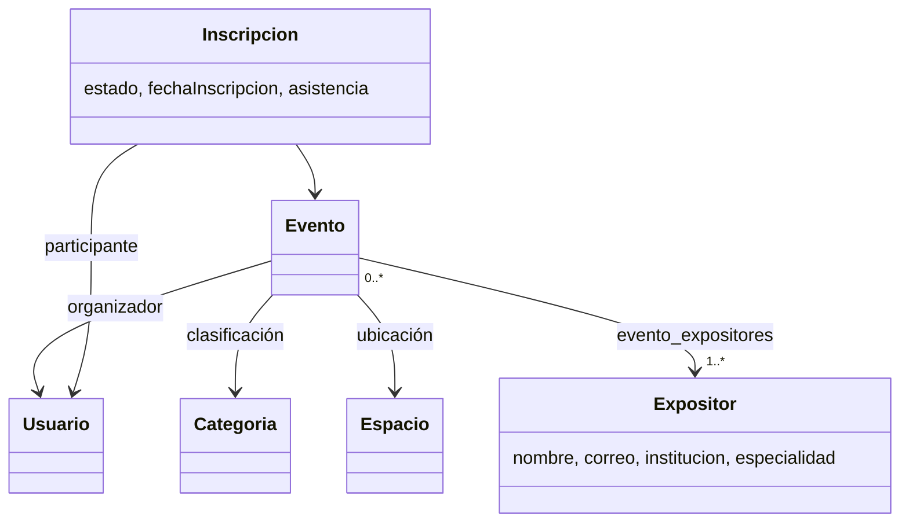

# Módulo 6: gestión de eventos académicos

Implementación del proyecto base y ajustes al informe del equipo (RF-01 a RF-12 de las capturas proporcionadas). Java 21, Javalin, JTE, JPA/Hibernate y PostgreSQL. Interfaz con CSS y JavaScript nativo. Se mantienen los usuarios y roles compartidos de la plataforma.

## Actores y permisos

| Rol del sistema | Actor del módulo | Funciones |
| --- | --- | --- |
| ESTUDIANTE | Participante | Agenda, búsqueda, filtros y detalle; inscripción y cancelación propia antes del inicio. |
| DOCENTE | Organizador | Creación y administración de sus eventos; registro/edición de expositores; lista y asistencia de sus inscritos. |
| ADMIN | Administrador y supervisor | Supervisión de eventos publicados/finalizados e inscritos sin modificar eventos; administración de salas, categorías, usuarios y roles asignados. |

Los permisos se verifican en el servidor además de ocultar controles en la interfaz. Solo DOCENTE crea, edita, publica, cancela y reactiva sus propios eventos; ADMIN no organiza eventos ni registra asistencia. DOCENTE organiza sus eventos y registra la asistencia de sus participantes. La inscripción y su cancelación se reservan a ESTUDIANTE; DOCENTE y ADMIN no disponen de esas acciones. DOCENTE no administra eventos ajenos. ESTUDIANTE no crea eventos, edita expositores, administra salas ni registra asistencia. La reactivación como borrador sigue disponible para organizadores autorizados y conserva el historial.

## Trazabilidad del informe

| Requisito | Implementación |
| --- | --- |
| RF-01: sesión y roles | AuthController y PermisosEventos; autorización por operación y CSRF. |
| RF-02: administrar eventos | Crear, editar, publicar, cancelar y recuperar como borrador. |
| RF-03: búsqueda y filtros | Título/ubicación, categoría y fecha; pestañas Agenda y Mis actividades. |
| RF-04: inscripción y cancelación con plazo | Cancelación permitida estrictamente antes de la fecha/hora de inicio, según la decisión del equipo. |
| RF-05: cupos y duplicados | Conteo activo y bloqueo del evento en la misma transacción; reactivación de un único registro cancelado. |
| RF-06: inscritos y asistencia | Listado completo o activo, impresión/PDF del navegador y marca de asistencia persistente. |
| RF-07: salas y ubicaciones | ADMIN crea, edita nombre/tipo/capacidad/disponibilidad y deshabilita; se impide reducir capacidad por debajo del cupo de un evento futuro. |
| RF-08: asignación de sala y horarios | Selector de ubicación disponible y fecha/hora de inicio y término. |
| RF-09: capacidad suficiente | Validación contra la capacidad real de la sala. |
| RF-10: cruces de horario | Comprobación y escritura transaccionales; no se permiten solapamientos de eventos no cancelados en la misma sala. |
| RF-11: uno o varios expositores | Catálogo editable, institución y especialidad; asociación muchos a muchos mediante evento_expositores. |
| RF-12: detalle | Ficha individual con fecha, horario, ubicación, cupos, categoría, organizador y todos los expositores. |

## Reglas y decisiones del equipo

- El plazo de cancelación cierra exactamente al iniciar el evento. El servidor rechaza intentos posteriores sin modificar la inscripción.
- La asistencia oficial la registra únicamente el organizador responsable del evento, incluso si otro usuario tiene rol ADMIN. El administrador supervisor puede consultar la lista sin modificar asistencia ajena. La asistencia se modifica únicamente en inscripciones activas de eventos publicados o finalizados. Se puede quitar una marca errónea. No se usa para alterar el estado de inscripción.
- Las ubicaciones y expositores son catálogos compartidos. Solo ADMIN registra categorías; los otros roles pueden consultarlas y los docentes seleccionarlas en sus eventos. Editar un expositor se refleja en los eventos donde participa. Renombrar una sala actualiza las ubicaciones de sus eventos.
- Los eventos cancelados no admiten nuevas inscripciones. Recuperarlos como borrador cancela sus inscripciones todavía activas y permite revisar sus datos antes de publicar. No se reactiva a asistentes automáticamente.
- Los borradores son visibles solo para su organizador autorizado. ADMIN puede supervisar eventos ajenos publicados o finalizados, pero no editarlos, cancelarlos, reactivarlos ni registrar su asistencia.
- Un horario termina antes o al comenzar el siguiente: los horarios consecutivos sí están permitidos.

## Base de datos y migraciones

En una base nueva: `docker compose up -d` ejecuta los scripts de `db/init` en orden. La base se conecta por localhost:5433 y el volumen postgres_data conserva los registros.

En una base existente, aplicar sin borrar el volumen:

1. 05_eventos_catalogos.sql: expositores, temática y ubicación.
2. 07_expositores_institucion.sql: institución separada de especialidad.
3. 08_evento_expositores.sql: relación de varios expositores, migrando los vínculos anteriores.
4. 09_asistencia.sql: asistencia con valor inicial false.
5. 10_categorias.sql: catálogo de categorías y conversión de las temáticas existentes.

El script 06_eventos_demo.sql carga los cuatro eventos de ejemplo y puede repetirse sin duplicarlos ni sobrescribir cambios. Los campos anteriores tematica y expositor_id se conservan para compatibilidad con esos datos iniciales. Las pantallas actuales utilizan categoría y la colección de expositores. El ejemplo inicial de Java que no tenía expositor o ubicación asociados requiere completarlos al editarlo.

Ejemplo de aplicación manual de una migración, desde PowerShell:

```powershell
$OutputEncoding = [System.Text.UTF8Encoding]::new()
Get-Content -Encoding utf8 db/init/10_categorias.sql | docker compose exec -T postgres psql -U postgres -d sigu_ucn -v ON_ERROR_STOP=1
```

No se necesita eliminar el volumen. El respaldo local previo se conserva en target/backups; los respaldos y cookies están excluidos de Git.

## Ejecución

```powershell
docker compose up -d
mvn compile exec:java "-Dexec.mainClass=cl.ucn.app.main.Main"
```

Abrir http://localhost:7000/eventos. Usuarios demo: admin@sigu.cl / admin123; docente@sigu.cl / docente123; estudiante@sigu.cl / estudiante123.

## Arquitectura y SOLID

Controladores: HTTP, autenticación, formularios y respuestas. EventoService: validaciones y estados. PermisosEventos: política común de autorización. PlazoCancelacion: regla temporal con Clock para pruebas reproducibles. Repositorios: persistencia y reglas que necesitan ejecutarse atómicamente.

EventoService depende del contrato pequeño EventoStore; las pruebas sustituyen la implementación con Mockito. Las responsabilidades de vistas, validaciones y acceso a datos están separadas. No se introduce herencia artificial. El bloqueo de tabla PostgreSQL de la agenda es deliberadamente simple para el taller; reduce la concurrencia de escrituras y mantiene la validación de horarios dentro de la transacción.



## Pruebas y evidencia

```powershell
mvn test
mvn test "-Deventos.integration=true"
```

Las pruebas unitarias no necesitan base de datos. La segunda orden habilita también pruebas sobre PostgreSQL real, con todas las migraciones y los usuarios demo. Cada prueba crea y elimina exclusivamente sus registros temporales. Se comprueban roles, validaciones, estados, horarios, cupos, duplicados, varios expositores, edición de catálogos, asistencia y límites temporales. Los resultados XML/TXT se encuentran en target/surefire-reports.

El informe del equipo debe acompañarse de sus diagramas de casos de uso, secuencia y actividad, presentación y gestión de tareas. Esta guía documenta la implementación, sin sustituir esos entregables.


## Contraseñas protegidas

Las claves nuevas se guardan con PBKDF2-HMAC-SHA256, sal aleatoria de 16 bytes y 600.000 iteraciones mediante la API estándar de Java. Parámetro basado en la [guía de OWASP](https://cheatsheetseries.owasp.org/cheatsheets/Password_Storage_Cheat_Sheet.html). El login rechaza texto plano y hashes malformados. Las semillas ya contienen hashes. Al iniciar, las cuentas antiguas se migran en una transacción sin cambiar su contraseña de acceso. La operación se puede repetir y no cambia hashes válidos. Para ejecutarla explícitamente: `mvn compile exec:java "-Dexec.mainClass=cl.ucn.app.main.MigrarPasswords"`. La columna compartida password mantiene su estructura; los módulos que autentiquen directamente deben usar el verificador común.

La inscripción y su cancelación muestran una confirmación explícita después de que PostgreSQL confirma la operación. Un error de cupos o plazo muestra su motivo y no presenta una confirmación falsa. El flujo de inscripción desde la agenda requiere como máximo tres pasos: elegir evento, revisar detalle y confirmar.

Las pruebas de integración lanzan solicitudes simultáneas mediante hilos y una barrera de salida: ocho peticiones del mismo usuario deben crear un único registro; ocho usuarios compiten por dos cupos; cuatro eventos compiten por una sala y horario. Se comprueba el estado final real de PostgreSQL y se eliminan solo los datos temporales de cada prueba.


## Rendimiento medido

Se incorporó el pool HikariCP mediante el módulo oficial de Hibernate, con máximo 20 conexiones y espera acotada, después de reproducir el agotamiento del pool interno bajo 100 sesiones. Ver [evidencia y procedimiento reproducible](rendimiento-eventos.md). La medición local corregida procesó 300 consultas sin errores y con un máximo inferior a dos segundos; su alcance se limita a las condiciones documentadas.


## Alcance de usuarios y roles

ADMIN administra las cuentas compartidas desde /eventos/usuarios: crea y edita usuarios, asigna uno de los tres roles existentes y activa o desactiva cuentas conservando el historial. No se crean tablas ni roles paralelos. El estado y rol se actualizan al acceder a las rutas de Eventos; la integración con otros módulos debe coordinarse con sus responsables.

Los catálogos rechazan a ESTUDIANTE con 403, incluso por URL directa. ADMIN ve Salas y categorías, sin expositores ni Mis actividades; DOCENTE gestiona expositores y consulta salas. ADMIN no puede desactivarse ni quitarse su propio rol.
