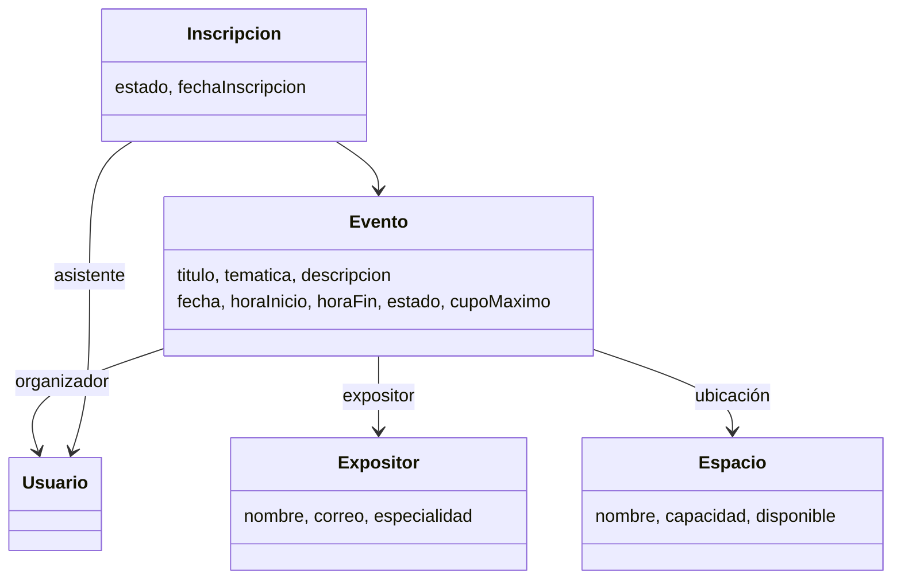

# Módulo 6: eventos académicos

Implementación basada en las secciones 4.6, 5, 8 y 9 de la pauta del taller. Se mantiene Java 21, Javalin, JTE, JPA/Hibernate, PostgreSQL, JUnit 5 y Mockito. El frontend usa CSS y JavaScript nativo; no se agregan frameworks ni dependencias de ejecución.

## Requisitos y trazabilidad

| Requisito del grupo 6 | Implementación | Verificación |
| --- | --- | --- |
| Registrar eventos | Formulario único de creación/edición, guardado como borrador | Servicio y prueba de persistencia |
| Registrar expositores | Catálogo persistente y selección en formulario | Prueba de catálogos y recorrido de navegador |
| Publicar cupos | Acción Publicar del organizador | Transiciones de estado |
| Inscribir asistentes | Inscripción de usuarios autenticados | Duplicados, cupo y reactivación |
| Cancelar inscripción | Cancelación lógica que conserva historial | Integración |
| Controlar cupos | Capacidad de sala, conteo activo y bloqueo transaccional | Unitarias e integración |
| Emitir lista de asistentes | Participantes: registros activos o historial e impresión/PDF del navegador | Recorrido de navegador |
| Consultar agenda | Pestaña Agenda: publicados que aún no comienzan | Recorrido de navegador |
| Filtrar por temática o fecha | Filtros combinables y búsqueda por título/ubicación | Recorrido de navegador |
| Administrar ubicaciones | Alta de salas, capacidad y disponibilidad, solo ADMIN | Control HTTP y catálogo |

Un evento cancelado no admite inscripciones. Un usuario no puede tener dos registros del mismo evento; se reactiva su registro cancelado. La agenda rechaza horarios solapados en la misma ubicación, incluso en borradores, y permite horarios consecutivos. Los eventos cancelados liberan el horario. El organizador administra sus propios eventos; otros usuarios ven los publicados y el historial. Los borradores son privados del organizador.

## Uso y actualización de una base existente

1. Levantar PostgreSQL: `docker compose up -d`.
2. Si el volumen ya existía, ejecutar la migración una sola vez (es repetible):

```powershell
Get-Content db/init/05_eventos_catalogos.sql | docker compose exec -T postgres psql -U postgres -d sigu_ucn -v ON_ERROR_STOP=1
```

3. Compilar e iniciar:

```powershell
mvn compile exec:java "-Dexec.mainClass=cl.ucn.app.main.Main"
```

4. Abrir http://localhost:7000/eventos. El usuario demo administrador es `admin@sigu.cl`, clave `admin123`.
5. Registrar un expositor en Expositores y ubicaciones. Seleccionar una ubicación disponible al crear el evento. Publicar para abrir las inscripciones.

Los eventos existentes conservan sus datos. Antes de volver a publicar o editar un evento antiguo, se debe completar su expositor y ubicación mediante el formulario. No es necesario eliminar el volumen. Las ubicaciones reutilizan la entidad compartida Espacio; su disponibilidad también afecta a los demás módulos que la consulten.

## Arquitectura y SOLID

- Presentación: EventosController recibe formularios y construye modelos JTE. InscripcionesController administra el acceso al flujo de inscripción.
- Negocio: EventoService valida título, fecha/hora, capacidad, expositor y cambios de estado. Clock permite pruebas reproducibles sin depender del día real.
- Persistencia: EventoRepository implementa EventoStore. CatalogoEventosRepository mantiene personas y salas. InscripcionRepository conserva conteos y reglas que deben ejecutarse atómicamente.
- S: validación de evento, HTTP, renderizado y acceso a datos tienen clases separadas.
- O y D: EventoService recibe EventoStore y Clock; permite usar otra persistencia o reloj sin cambiar sus reglas.
- L: EventoRepository y el doble Mockito satisfacen el contrato EventoStore. No se agrega herencia artificial.
- I: EventoStore expone únicamente las operaciones necesarias para eventos.

La protección contra cruces de sala se ejecuta en la misma transacción que la escritura. Un bloqueo de tabla PostgreSQL serializa las escrituras de agenda: es una solución simple apropiada para el alcance del taller, con menor concurrencia que una restricción de exclusión. Las inscripciones bloquean la fila del evento para controlar cupos. No se introducen migradores, microservicios ni infraestructura adicional.

## Modelo de datos



## Pruebas

```powershell
mvn test
mvn test "-Deventos.integration=true"
```

La primera orden ejecuta 12 pruebas unitarias sin base de datos. La segunda habilita además 5 pruebas de integración reales sobre PostgreSQL. Estas crean salas, expositores y eventos temporales y eliminan exclusivamente sus propios registros al terminar. Requieren el esquema inicial, la migración 05 y los usuarios demo admin y estudiante. No usar una base de producción.

Evidencia: informes XML y TXT en `target/surefire-reports`. Las pruebas verifican validaciones, estados, catálogos, persistencia, solapamiento, horarios consecutivos, duplicados, reactivación, sobrecupo y cancelación.

Recorrido visual verificado en Chrome: registro de expositor, creación y publicación, búsqueda, agenda, formulario de edición, lista imprimible y cancelación. Resoluciones: 1440×1000 y 390×844, sin desplazamiento horizontal de la página. Capturas locales: `target/eventos-escritorio.png`, `target/eventos-movil.png` y `target/eventos-formulario.png`.

## Alcance de la entrega

Este archivo documenta el módulo implementado; no sustituye los documentos, diagramas de casos de uso/secuencia/actividad, presentación, tablero Kanban o defensa que el equipo debe preparar según el taller. No se publican commits ni se modifica GitHub automáticamente. La rama de trabajo actual es grupo-6.


## Reactivar un evento cancelado

El organizador puede usar **Reactivar como borrador**. Esta operación conserva el evento y su historial, cancela las inscripciones que aún figuraban activas y abre el formulario de edición. No publica ni vuelve a inscribir asistentes automáticamente.

Se permite recuperar el borrador aunque su fecha haya pasado o su sala esté ocupada, para poder corregirlo. Guardar y publicar vuelven a exigir fecha futura, sala disponible, capacidad suficiente y ausencia de cruces de horario. Solo se reactiva desde CANCELADO; la operación es transaccional y requiere sesión, organizador y token CSRF.


## Datos iniciales y respaldo

`db/init/06_eventos_demo.sql` registra los cuatro eventos solicitados con sus expositores y ubicaciones. Se ejecuta después de la migración 05 y puede repetirse sin duplicar los eventos ni sobrescribir cambios existentes. En una base nueva, Docker ejecuta ambos scripts automáticamente. En volúmenes existentes deben aplicarse explícitamente.

El estado actual completo (esquema, eventos, usuarios, ubicaciones, expositores e inscripciones) se respaldó en `target/backups/sigu_ucn_20261111_154811.sql`. El respaldo es local y no se incluye en Git. El volumen `postgres_data` mantiene los datos al detener y reiniciar Docker.


## Permisos según los actores del informe

ESTUDIANTE actúa como participante: consulta, filtra, se inscribe y cancela su inscripción. DOCENTE actúa como organizador: crea y administra sus eventos y expositores. ADMIN supervisa todos los eventos y administra las ubicaciones. Los permisos se verifican tanto en HTTP como en los botones de las vistas. Los eventos antiguos creados por administradores se conservan.
